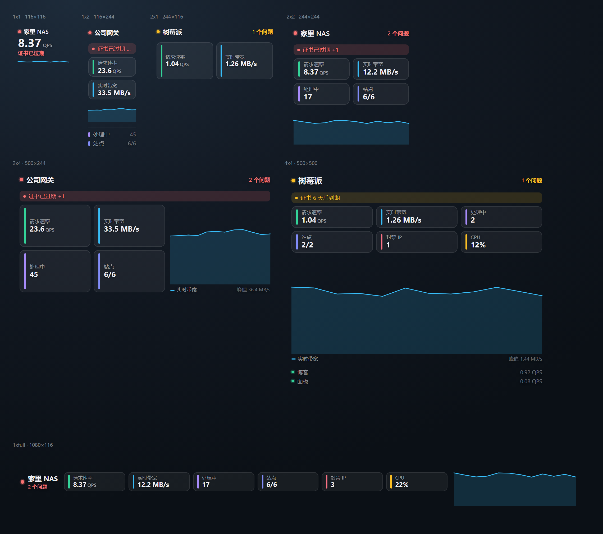

# Sun-Panel 微应用合集

给 [Sun-Panel](https://sunpanel.top) 导航面板写的几个小应用。每个都是独立微应用包，可单独安装。

| | | |
|---|---|---|
|  |  |  |

| 应用 | 一句话 | 目录 | 文档 |
|---|---|---|---|
| **日历倒计时** | 背景真正透明的日历 / 倒计时卡片，支持农历、节气与纪念日，七种尺寸自适应 | [`calendar/`](calendar/) | [说明](calendar/README.md) · [更新](calendar/CHANGELOG.md) |
| **音乐** | 卡片即播放器，点开有专辑墙、搜索与同步歌词，兼容 Subsonic 接口 | [`music/`](music/) | [说明](music/README.md) · [更新](music/CHANGELOG.md) |
| **Gately 网关** | 自托管网关 Gately 的看板，卡片看 QPS / 带宽 / 拦截，支持多台服务器 | [`gately/`](gately/) | [说明](gately/README.md) · [更新](gately/CHANGELOG.md) |

当前版本：日历倒计时 `2.0.0` · 音乐 `3.0.3` · Gately 网关 `1.3.0`

## 目录结构

```
.
├─ calendar/            日历倒计时（独立工程）
├─ music/               音乐（独立工程）
├─ gately/              Gately 网关（独立工程，另带本地模拟器）
├─ docs/                仓库级文档
│  ├─ 开发指南.md
│  ├─ 发布与上架.md
│  ├─ 提交规范.md
│  ├─ SECURITY.md                安全说明（回应静态扫描）
│  └─ UPGRADE_APP_JSON_VERSION.md
└─ LICENSE              统一许可证：禁止商业使用
```

三个工程结构一致、互不依赖，各自 `npm install && npm run dev` 即可开发。

## 快速开始

```bash
cd gately              # 或 calendar / music
npm install
npm run dev            # 开发服务器，热更新
npm run pack           # 打包到 packages/
```

开发时可以把开发服务器的「入口 JS 地址」直接导入 Sun-Panel 预览，不必每次打包上传。细节见 [开发指南](docs/开发指南.md)。

## 文档

- [开发指南](docs/开发指南.md) — 脚手架、构建链路、预览页、模板同步、新增应用
- [发布与上架](docs/发布与上架.md) — 版本号、打包自检、截图规范、审核要点
- [提交规范](docs/提交规范.md) — 提交粒度与格式
- [安全说明](docs/SECURITY.md) — 静态扫描提示的来源与风险判断

## 许可证

**禁止商业使用。** 个人可免费使用、免费修改；分发需保留署名与本许可证；修改后须标注「已修改」并同样禁止商用；商用需书面授权。

源码公开是为了让人能核对网络行为，不构成 OSI 定义的开源许可。完整条款见 [LICENSE](LICENSE)。联系：[GitHub @chenggegedeid](https://github.com/chenggegedeid)
