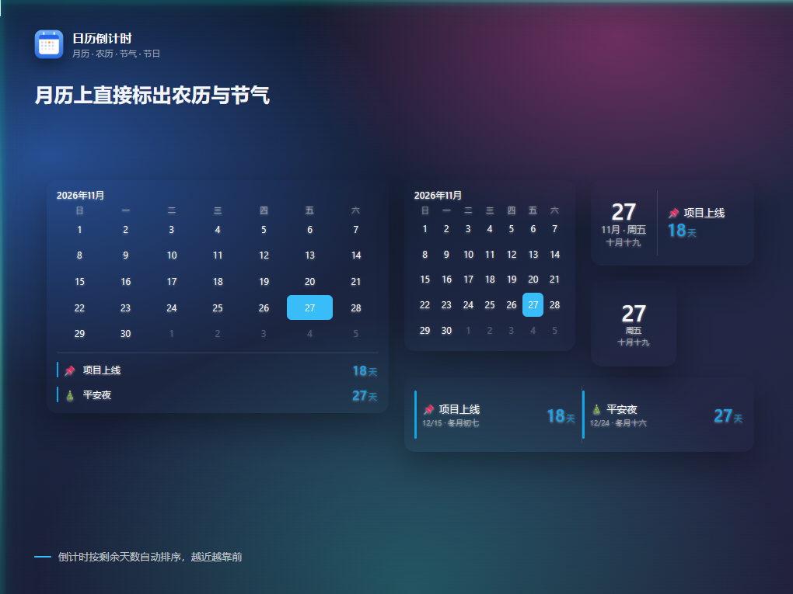
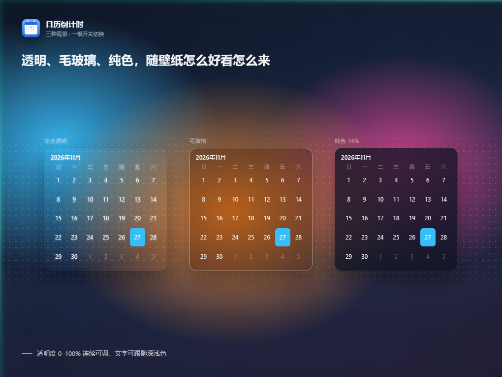
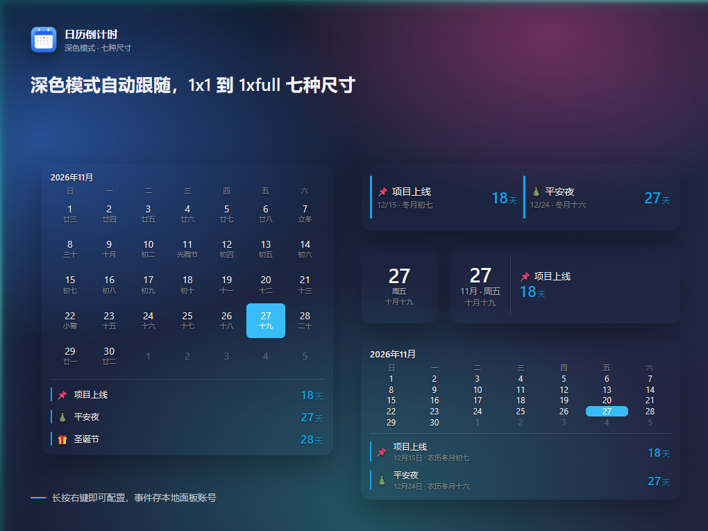

# 日历倒计时 · Sun-Panel 微应用

一个背景**真正透明**的日历 / 倒计时卡片，支持农历、节气、内置节日与自定义纪念日。

> 起因：商店里的「时光倒计时」实际做不到背景透明——它虽然给卡片设了 `background: transparent`，
> 但内部卡片写死了 `linear-gradient(180deg, #ffffff, #f8fbff)`，在壁纸上就是一条白条。
> 本项目从容器到内容都不画任何不透明底色，并额外把宿主卡片背景一并置为透明。

## 预览




| 透明 / 毛玻璃 / 纯色 | 深色模式与多尺寸 |
|---|---|
|  |  |

## 特性

- **三种背景模式**：完全透明 / 毛玻璃（backdrop-filter）/ 纯色（0–100% 不透明度）
- **七种尺寸**：`1x1` `1x2` `2x1` `2x2` `2x4` `4x4` `1xfull`，每种尺寸单独排版
- **农历与节气**：1900–2100 年公历农历互转，二十四节气，月历上标注节日 / 节气 / 农历日
- **倒计时**：生日、纪念日、重要日子，支持每年重复；内置 15 个公历节日 + 10 个农历节日 + 清明
- **真实日历**：按当月实际跨周数渲染行数，不会再出现 31–42 这种不存在的日期
- **深色模式自适应**、强调色可调、文字颜色可跟随 / 强制浅色 / 强制深色 / 自定义

## 透明是怎么做到的

三层配合，缺一层都会留白底：

1. `config/components.config.js` 里给 widget 加
   ```js
   background: 'transparent',
   isModifyBackground: true,   // 未公开文档，但主应用会读它
   ```
   `isModifyBackground` 让主应用用 widget 的 `background` 覆盖卡片默认底色。
2. 组件内部 `:host` 与 `.container` 都不设任何背景色，只画边框和文字。
3. 保存配置时再把卡片背景写一次，避免宿主忽略第 1 步：
   ```js
   await api.widget.save({
     ...spCtx.widgetInfo,
     background: 'transparent',   // 关键
     config: { bgMode, bgColor, bgOpacity, ... },
   });
   ```

文字可读性靠 `text-shadow`（透明模式下默认开启，可在配置里关掉）。

## 开发

需要 Node.js >= 18.20。

```bash
npm install
npm run dev      # 本地开发，会打开带 mock 宿主的预览页
npm run pack     # 打包生产版本，产物在 packages/
npm run pack:test # 打包测试版，microAppId 自动加 -test 后缀并开启 debug
```

自带的两个预览页（不会被打进发布包）：

- `preview.html` —— 七种尺寸 × 透明 / 毛玻璃 / 纯色 × 深浅色，铺在渐变壁纸上对比
- `preview-pages.html` —— 配置页与主页面的整页预览

## 标识

`config/app.config.js`：

```js
author: 'chenggegedeid',              // 开发者标识
microAppId: 'chenggegedeid-calendar', // 开发者标识-应用名
version: '1.0.0',
```

`microAppId` 前缀必须与 `author` 一致（商店创建应用时也是 `chenggegedeid-` 开头）。
如果商店里已建的应用 ID 不是 `chenggegedeid-calendar`，把这一行改成一致即可，
否则安装包会被当成另一个应用。

改完 `npm run pack`，把 `packages/*.zip` 上传到
[Sun-Panel 应用商店](https://appstore.sun-panel.top/) → 开发者中心 → 我的微应用。

## 商店上架要填的东西

| 字段 | 说明 | 本项目 |
|---|---|---|
| 应用图标 | 1:1 正方形，≤512KB | `public/icon.png`（256×256） |
| 所属分类 | 下拉选择 | 生活 |
| 收费方式 | 免费 / 积分 / PRO 免费 | 免费 |
| 三方内购 | 有无站外付费 | 不含 |
| 开源仓库地址 | GitHub / Gitee | 本仓库 |
| 反馈方式 | 网址 / QQ群 / 邮箱 | 留你的 |
| 应用截图 | 4:3，≤2MB，推荐 1020×1440 | 自己截 3–4 张（透明、毛玻璃、手机视图各一张更直观） |

## 目录

```
config/
  app.config.js          # 应用信息、权限（dataNode）、数据节点
  components.config.js   # 页面与小部件注册（含 isModifyBackground）
src/
  components/
    widget.js            # 小部件，七种尺寸的排版
    widgetConfig.js      # 配置页：事件管理 + 外观
    mainPage.js          # 主页面：大月历 + 即将到来
  utils/
    lunar.js             # 农历、节气、节日表
    events.js            # 倒计时计算与排序
    theme.js             # 背景 / 文字样式，三种背景模式
locales/                 # zh-CN / en-US
public/icon.png          # 应用图标
build/make-icon.mjs      # 图标生成脚本（纯 Node 手写 PNG，可改色重生成）
```

## 数据存储

事件存在**用户级**数据节点 `events.list` 里（`scope: 'user'`，多账号各自独立），
所以同一账号下的所有卡片共享同一份事件列表，换卡片尺寸不会丢数据。

## 许可

基于 Sun-Panel 官方模板（[microapp-hello-world](https://github.com/Sun-Panel/microapp-hello-world)）开发。

---

## 许可证

**禁止商业使用。** 个人可免费使用、修改；分发需保留署名与许可证，修改后须标注「已修改」并同样禁止商用。

完整条款见 [LICENSE](../LICENSE)。
