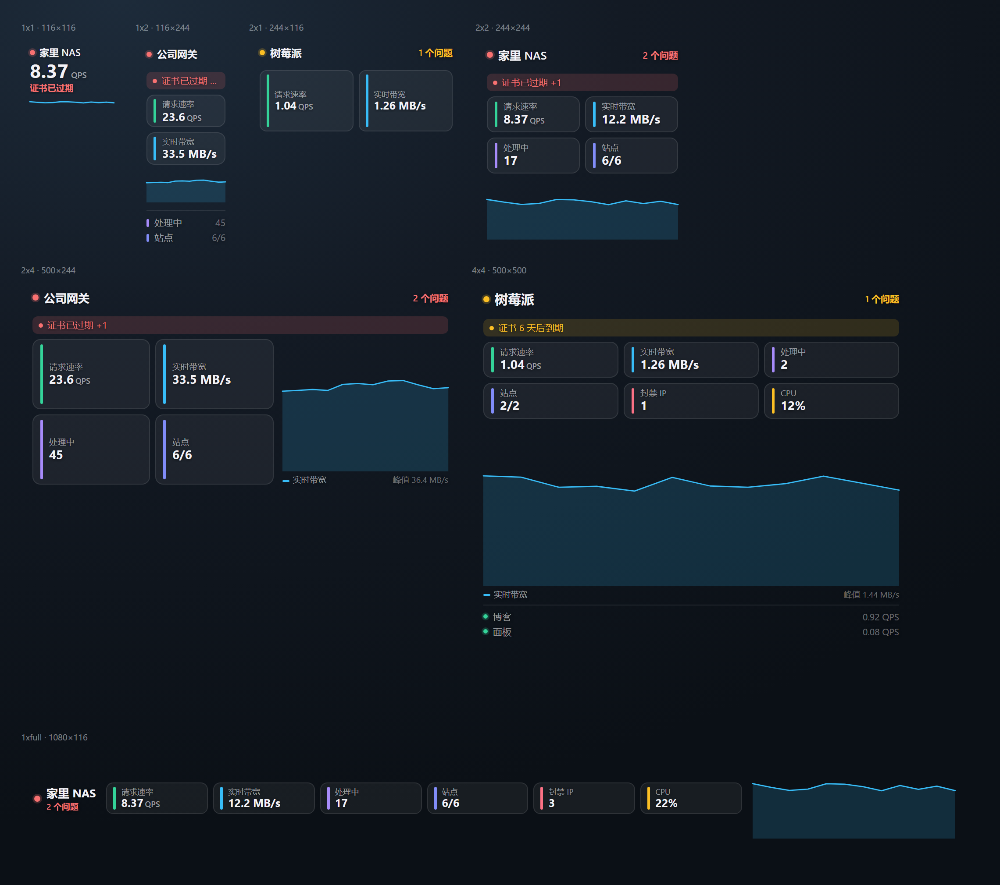
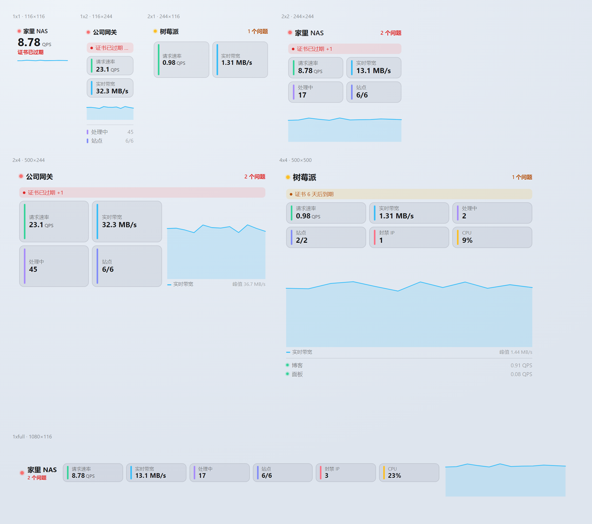
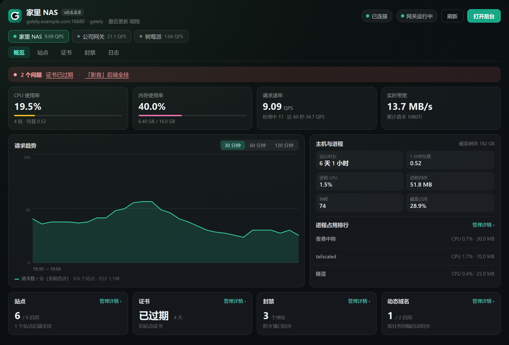
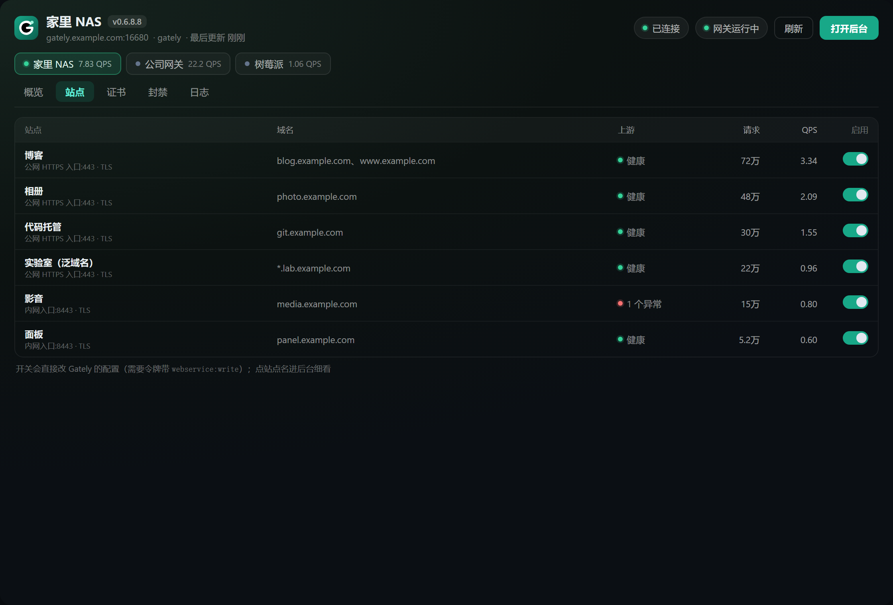
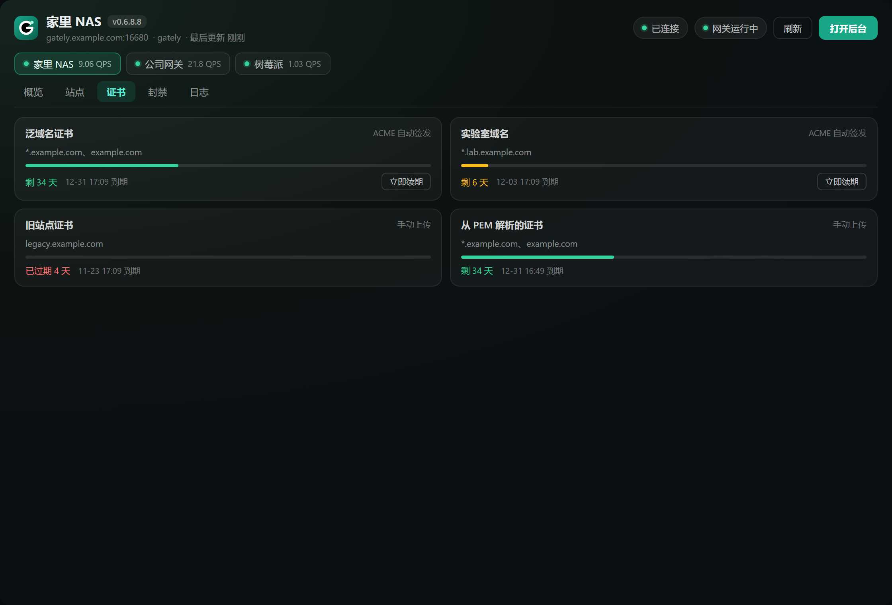
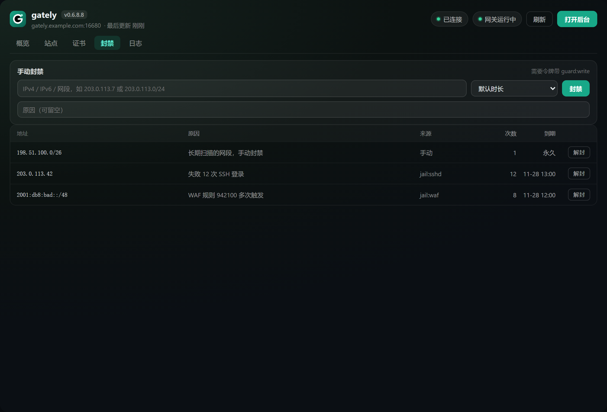
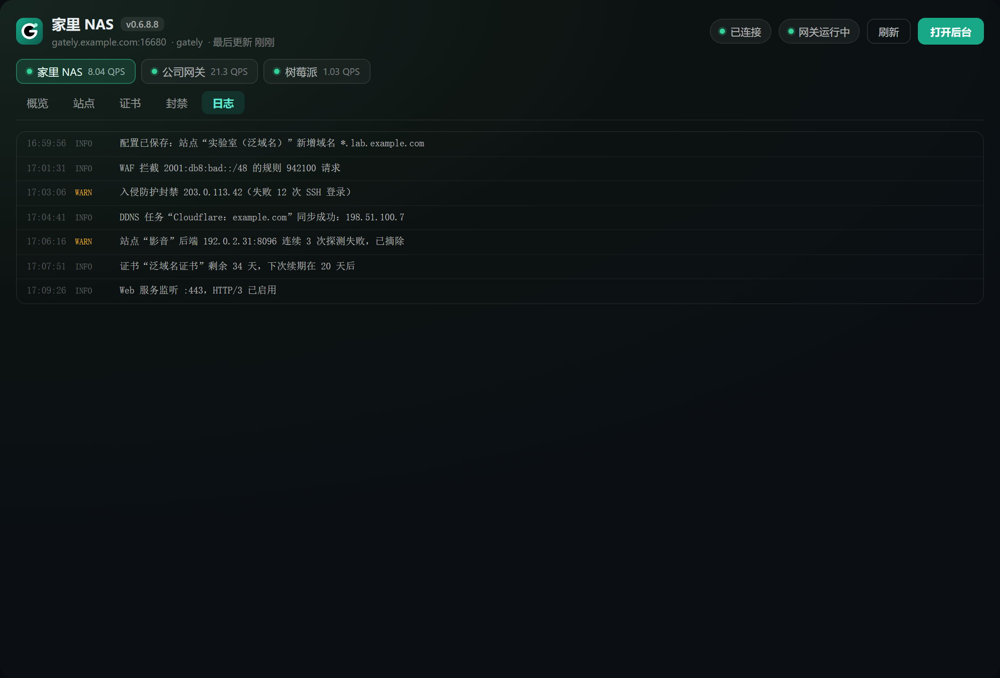
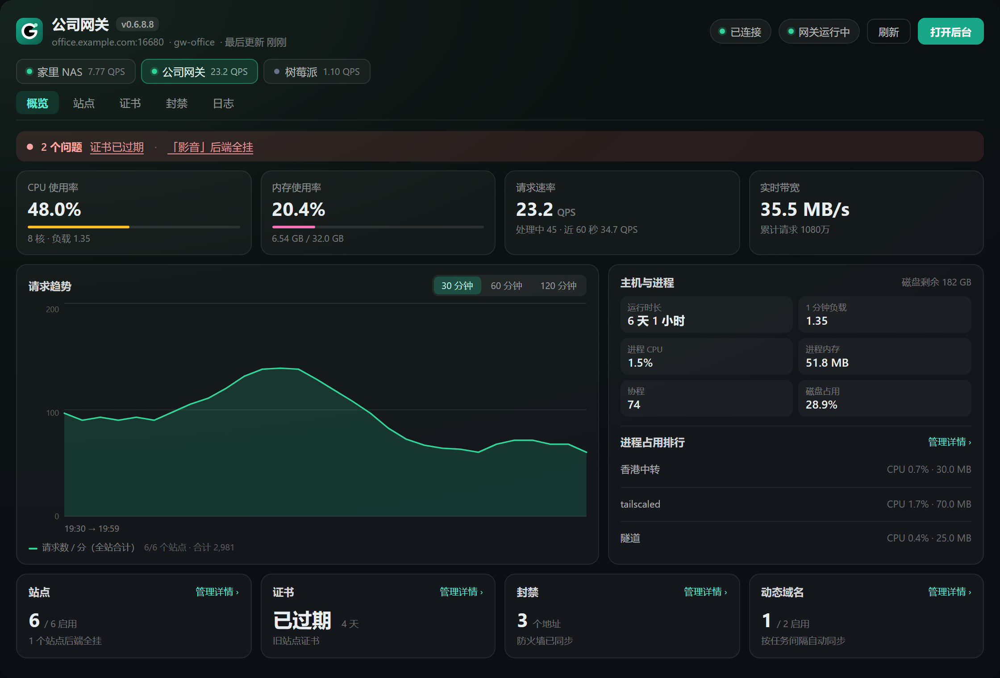
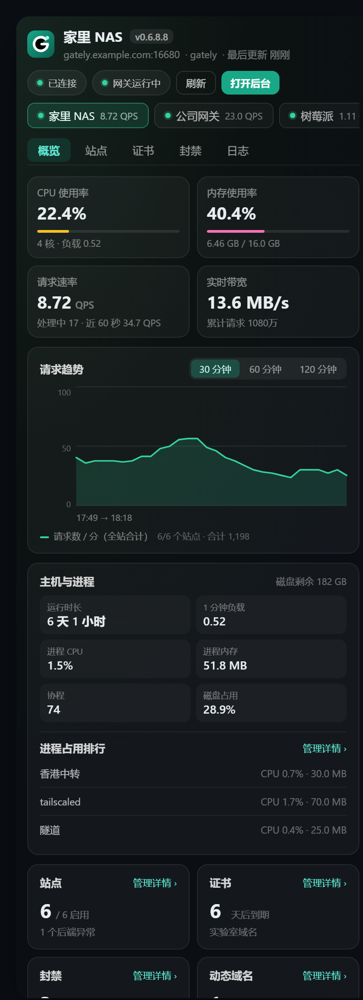
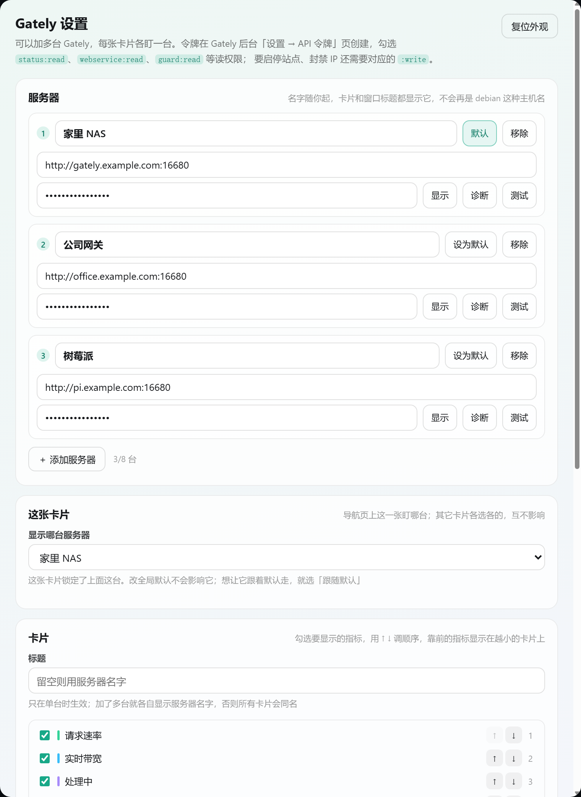

# Gately 网关 · Sun-Panel 微应用

把自托管网关 [Gately](https://github.com/wangwanjie/gately) 的运行状态装进导航页，**支持同时监控多台**。卡片上就能看到 QPS、实时带宽、进行中请求、站点与拦截数；点开是完整的网关控制台——看站点明细、证书到期、封禁名单，也能直接启停站点、封禁或解封 IP。

> Gately 是单文件 Go 网关：反向代理、自动 HTTPS、DDNS、NAT 穿透、WAF 和 fail2ban 式封禁。文档见 [gately.cn/docs](https://gately.cn/docs/modules/)。
>
> ⚠️ **禁止商业使用**，详见 [LICENSE](../LICENSE)。

---

## 预览





| 概览 | 站点 |
|---|---|
|  |  |

| 证书 | 封禁 | 日志 |
|---|---|---|
|  |  |  |

多台时主窗口顶部多一排服务器标签（带在线状态与实时 QPS），点一下整页跟着切：



手机上的样子（390 宽，卡片与窗口都做了窄屏重排）：





## 功能

**多台服务器**

- 设置里维护一份服务器清单（名字、地址、令牌），最多 8 台，逐台「测试连接」看权限
- **每张卡片绑一台**：想同时盯三台就摆三张卡，各显示各的指标和曲线
- 卡片标题用**你自己起的名字**（「家里 NAS」「公司网关」），不是 `debian` 这种主机名；主机名放在副标题里便于核对
- 主窗口顶部一排服务器标签，点一下切换，下面五个标签页跟着换；标签上带在线状态和实时 QPS
- 每台独立轮询、独立缓存，切回去不用重新等

**卡片到底显示哪台？按这个顺序判断**

| 情况 | 显示 |
|---|---|
| 「这张卡片」下拉里选的是**具体某台** | 锁定那台，改全局默认**不影响**它 |
| 「这张卡片」下拉是**跟随默认** | 跟着「设为默认」的那台走，改默认立刻生效 |
| **新添加的卡片** | 默认就是「跟随默认」，所以先把默认设好，新加的卡片就指向它 |

设置页下拉下方会直接写明当前是哪种状态。想让所有卡片都跟着默认走，把每张卡的「这张卡片」都选成「跟随默认」即可。

**手机上**

卡片与窗口都按窄屏重排，不需要额外设置：

- `1xfull` 在手机上变成「名字 / 指标 / 曲线」三段，指标按宽度留 2 至 3 个
- 主窗口：KPI 两列、趋势图固定高度、整页上下滚动；切换条与标签栏可横向滑动
- 站点与封禁列表变成逐行卡片，开关和解封按钮贴在右侧
- 设置页输入框全宽、按钮换行，字号按 iOS 规范提到 16px（否则点输入框页面会自动放大）

**卡片（7 种尺寸，逐个排版）**

| 尺寸 | 卡片上有什么 |
|---|---|
| `1x1` | 状态点 + 主指标大数字 + 次指标 + 迷你曲线（不填充，最省地方） |
| `1x2` | 2 个指标块 + 趋势曲线 + 2 行小指标 |
| `2x1` | 2 个指标块横排，适合塞在窄条里 |
| `2x2` | 4 个指标块 + 趋势曲线 |
| `2x4` | 左侧 4 个指标块，右侧曲线 + 图例 |
| `4x4` | 6 个指标块 + 大曲线 + 前 3 个站点的实时 QPS |
| `1xfull` | 一行读完：名称状态 + 6 个指标 + 右侧曲线 |

- 指标可自选、可排序：请求速率 / 实时带宽 / 处理中 / 站点 / 封禁 IP / 拦截 / CPU / 内存 / 累计请求
- 趋势曲线三种模式：自动（有带宽看带宽、没带宽看 QPS）/ 只看带宽 / 只看 QPS / 不显示
- 三种底色：完全透明（默认）/ 毛玻璃 / 纯色，圆角与不透明度可调
- 文字颜色跟随宿主深浅色，也可强制浅色 / 深色 / 自定义
- 点卡片任意位置进入主窗口

**主窗口（五个标签）**

- **概览**：CPU / 内存 / 请求速率 / 实时带宽四个 KPI，30 / 60 / 120 分钟趋势图（带 5xx 虚线），主机与进程信息、进程占用排行，底部四个入口卡直达站点、证书、封禁、动态域名
- **站点**：站点名、域名、上游健康、请求数、QPS，右侧开关直接启停
- **证书**：域名、到期进度条、剩余天数，一键续期
- **封禁**：手动封禁表单（地址 / 时长 / 原因）+ 当前名单 + 解封
- **日志**：按级别着色的系统日志

**写操作**（不走假接口，直接改 Gately 配置）

启停站点 → `POST /api/webservice/sites/batch` · 封禁 → `POST /api/guard/bans` · 解封 → `DELETE /api/guard/bans` · 续期 → `POST /api/ssl/certs/{key}/renew`

每一项旁边都能跳到 Gately 后台对应页面（`#/web`、`#/ssl`、`#/guard` …），要做更细的改动不用来回找入口。

---

## 令牌权限

在 Gately 后台「设置 → API 令牌」新建，勾选下面的权限域：

| 权限 | 需要它的功能 | 只读监控 |
|---|---|---|
| `status:read` | 主机名、版本、CPU、内存、磁盘、进程 | 必须 |
| `webservice:read` | 站点列表、QPS、带宽、上游健康、趋势图 | 必须 |
| `guard:read` | 封禁数量、防护状态 | 必须 |
| `ssl:read` | 证书列表与到期时间 | 建议 |
| `ddns:read` | 动态域名任务 | 建议 |
| `logs:read` | 系统日志 | 建议 |
| `webservice:write` | 启停站点 | 可选 |
| `guard:write` | 封禁 / 解封 IP | 可选 |
| `ssl:write` | 证书续期 | 可选 |

配置页的「测试连接」会逐个探测这 6 个读权限，哪个没勾一眼就能看出来：

```
✓ 系统状态 status:read          可用
✓ 站点与拓扑 webservice:read     可用
✕ 封禁与防护 guard:read          无权限
```

只做监控就只勾读权限；`guard:write` 能让面板封禁任意 IP，**按需给**。

---

## 安装

1. 打开 Sun-Panel 的**应用商店**，搜索「Gately」
2. 安装后在导航页「添加小部件」里选「Gately 网关」
3. 首次添加会提示配置，点进去填地址和令牌

从 `.zip` 手动安装：应用中心 → 手动安装 → 选择 `chenggegedeid-Gately-1.1.0.zip`。

---

## 配置

设置页分两层：**服务器清单**（全局，所有卡片共用）和**这张卡片**（每张卡各选一台）。

**服务器**：点「＋ 添加服务器」，每台填三样：

| 字段 | 填什么 | 例子 |
|---|---|---|
| 名字 | 随你起，卡片和窗口标题都显示它 | `家里 NAS` |
| 管理地址 | Gately 后台的地址，**填到端口那一层** | `http://192.168.1.10:16680` |
| API 令牌 | 上一节建的令牌，`gtl_` 开头 | `gtl_xxxxxxxx` |

每行右侧：「测试」逐项探测 6 个读权限，「设为默认」决定主窗口默认打开哪台，「移除」点两次才生效（第一次变成「确认移除」，3 秒不点自动收回）。

**这张卡片**：多台时多出一个下拉，选这张卡盯哪台；选「跟随默认」就跟着服务器清单里的默认那台走。同一台机器摆两张卡也可以，比如一张只看 CPU、一张只看请求。

**刷新间隔**：5–300 秒，默认 15，所有台共用。

### 地址怎么填

| 情况 | 正确写法 | 错误写法 |
|---|---|---|
| 默认端口 | `http://192.168.1.10:16680` | ~~`http://192.168.1.10:16680/`~~ |
| HTTPS 反代 | `https://gw.example.com` | ~~`https://gw.example.com/#/overview`~~ |
| 挂在子路径 | `https://nas.example.com/app/gately` | ~~`https://nas.example.com/app/gately/`~~ |
| 有站点也走同一个反代 | 指到**管理端口** `http://192.168.1.10:16680` | ~~`https://blog.example.com`~~（那是被代理的站点，不是管理界面） |

地址里的 `#/overview` 这类 hash 路由、结尾的斜杠会被自动去掉，但**子路径要保留**。不带协议时会按端口猜：`16680` → `http`，`443` → `https`。

**怎么确认地址对不对**：用浏览器打开 `你的地址/api/status`——看到一段带 `version`、`host` 的 JSON 就是对的；看到网页就说明地址没指到接口根（Gately 的前端是单页应用，路径不对不会返回 404，而是把首页以 200 返回）。

### 面板是 HTTPS 时

微应用的请求走 Sun-Panel 宿主的网络透传（`api.network.request`），不受浏览器同源策略限制，所以：

- Gately 是 HTTP 也能连（面板是 HTTPS 也没关系），因为请求由宿主发出
- 反代不需要额外配 CORS

这也是为什么安装时应用会申请 `network` 权限。

---

## 使用

**卡片**

- 点**任意位置** → 打开主窗口
- 没配好时卡片会直接提示「点这里填管理地址与 API 令牌」，点一下进配置
- 连接失败时卡片底部出现红色错误条，点它也能进配置

**主窗口**

- 顶部显示**你起的名字**、版本、管理地址、主机名和最后更新时间，右上角「打开后台」跳到这台 Gately 的原界面
- 多台时标题下面有一排服务器标签，带在线状态点和实时 QPS，点一下切换；只有一台时这行不出现
- 「刷新」立即重拉当前这台；平时按刷新间隔自动更新，页面切到后台时暂停（`document.hidden`）
- 趋势图切换 30 / 60 / 120 分钟会重新拉一次统计
- 站点开关有二次确认式的忙碌态，改完立刻回读，不会出现「开关动了但实际没改」

---

## 常见问题

**「Web 服务模块没有启用」/ 站点页空白**
Gately 里 Web 服务模块没开，或令牌缺 `webservice:read`。到后台模块管理里开启，或补权限。

**「连接失败：401 / 403」**
401 是令牌无效或过期；403 是令牌有但缺对应权限域，看配置页「测试连接」的逐项结果。

**「接口返回 200，但内容不是 Gately 的接口数据」**
地址没指到接口根。Gately 的前端是单页应用，路径不对时不会返回 404，而是把首页 HTML 以 200 返回，所以看着像“连上了”其实连的是网页。
在浏览器打开 `你的地址/api/status`：看到带 `version`、`host` 的 JSON 才对。几种常见填错：填成了被 Gately 代理的**站点域名**、填成了 Sun-Panel 面板自己的地址、子路径部署时漏了路径前缀。

**「连接失败：请求超时」**
多为地址写错（漏端口 / 多了路径）。先在同网络的浏览器里打开 `地址/#/overview` 确认能进。

**卡片上都是 `—`**
权限只给了 `status:read`，`topology` 拉不到，所以 QPS、带宽、站点都是空的。补 `webservice:read`。

**卡片标题是 `debian` 这种主机名，不是我的名字**
从 1.0.0 升级上来时，清单里的名字先用了主机名（旧版只存了地址）。到设置里改成「家里 NAS」这类叫法，保存后下一轮刷新就换过来。

**加了两台但只剩一台**
两台填了完全相同的地址和令牌会被当成同一台合并掉，保存时会提示「N 台地址重复，已合并」。

**证书的到期时间是从哪来的**
Gately 的 `/api/ssl/certs` 只返回证书 PEM 原文，没有现成的到期字段。前端在浏览器里解析证书里的有效期和 SAN 域名，所以即使面板拿不到别的元数据，剩余天数也是准的。

**趋势图是空的，只有一条线**
`/api/webservice/stats` 拿不到时，会退回用面板自己采的样本，刚开始只有一两个点。等几轮刷新就有了。

**启停站点报「只读令牌」**
令牌没勾 `webservice:write`。这是故意的——读和写分开授权。

**封禁之后没生效在防火墙上**
Gately 的封禁要同步到防火墙，概览里「防火墙已同步 / 未生效」会写清楚。未生效通常是 Gately 那边没权限操作 nftables/iptables。

---

## 开发调试

```bash
npm install
npm run dev        # 开发服务器，带热更新
npm run lint       # eslint（0 error / 0 warning）
npm run pack       # 打包到 packages/
```

**本地模拟器**

没有 Gately 实例也能开发：`tools/mock-gately.js` 起了 `/mock-gately/*` 一组假接口，数据是平滑波动的，站点启停和封禁解封会真的改内存。

**预览页**

打开 `http://localhost:3000/dev-preview.html`，可以切主题、切尺寸、单独打开主窗口或设置页。加参数可以只截某一块：

| 参数 | 作用 |
|---|---|
| `?shot=1` | 去掉工具栏和标注，纯净截图 |
| `?theme=light|dark|both` | 卡片主题，截图底色跟着变 |
| `?only=4x4` | 只渲染一个尺寸 |
| `?panel=main` / `?panel=config` | 只渲染主窗口 / 设置页 |
| `?tab=sites` | 主窗口直接打开某个标签 |
| `?srv=0|1|2` | 预览演示清单里的某一台 |
| `?h=760` | 主窗口高度（截图用） |

`dev-preview.html` 会强制 `document.hidden = false`，否则无头浏览器里轮询会被当成后台页跳过，曲线永远只有一个点。

**目录**

```
src/
├─ components/
│  ├─ widget.js        卡片：七种尺寸各自排版，绑定一台服务器
│  ├─ mainPage.js      主窗口：服务器切换 + 概览 / 站点 / 证书 / 封禁 / 日志
│  └─ widgetConfig.js  设置页：服务器清单、卡片绑定、刷新、指标、外观
└─ utils/
   ├─ api.js           Gately 接口封装、地址归一化、错误映射
   ├─ gateway.js       每台一份状态：引用计数轮询、趋势采样、快照归一
   ├─ servers.js       服务器清单：读写、迁移、卡片绑定、保存广播
   ├─ x509.js          从证书 PEM 里读到期时间与域名
   ├─ format.js        数字 / 字节 / 带宽 / 时间格式化
   └─ theme.js         指标定义、配色、背景与文字主题
```

---

## 许可证

**禁止商业使用。** 个人可免费使用、修改；分发需保留署名与许可证；修改后须标注「已修改」并同样禁止商用；商用需书面授权。

完整条款见 [LICENSE](../LICENSE)。联系：[GitHub @chenggegedeid](https://github.com/chenggegedeid)
