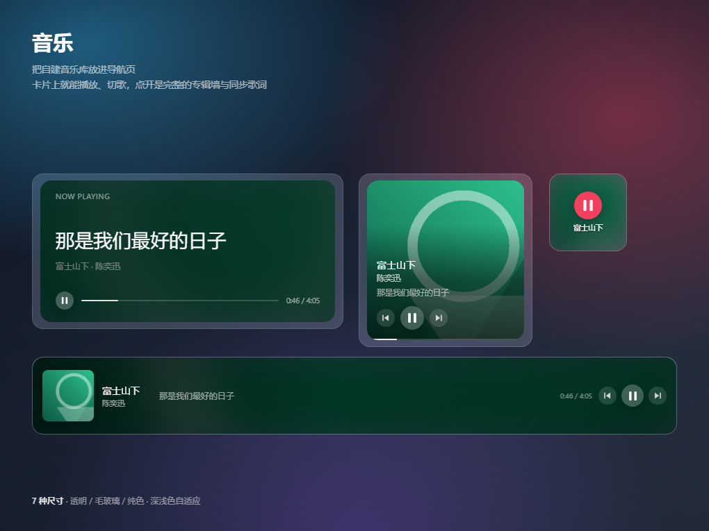
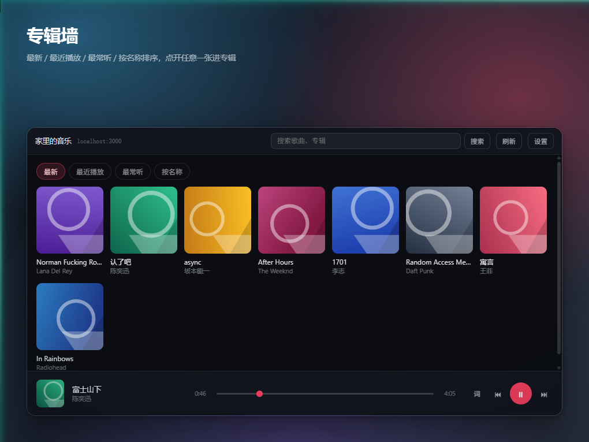
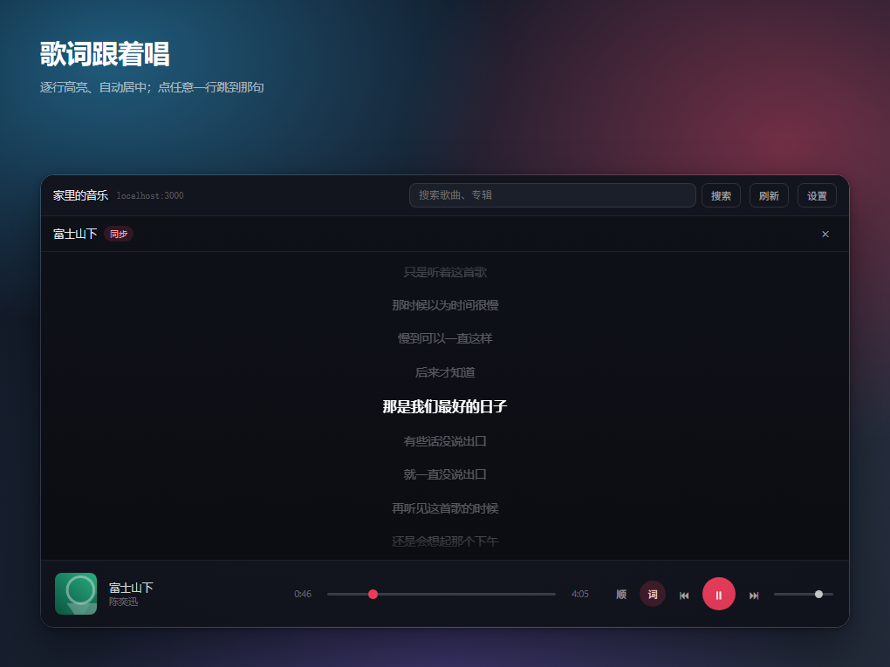
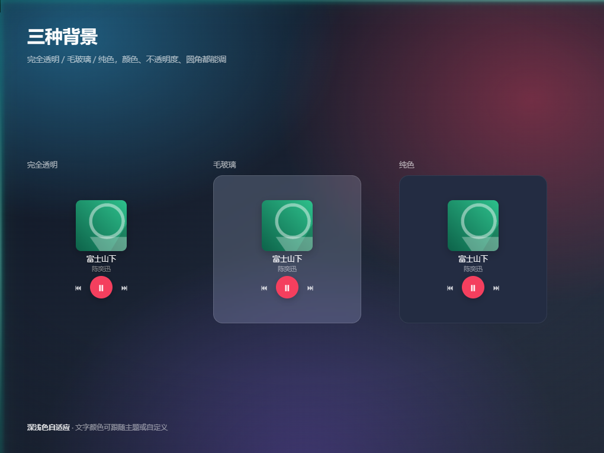

# 音乐 · Sun-Panel 微应用

在导航页里直接播放你自建的音乐库。卡片本身就是播放器，点开是完整的专辑墙、搜索和同步歌词。

> 兼容 **Navidrome / Gonic / Airsonic / Jellyfin** 等 Subsonic 接口服务，也支持自建的 **简听** 音乐站。
>
> ⚠️ **禁止商业使用**，详见 [LICENSE](../LICENSE)。

---

## 预览



| 专辑墙 | 同步歌词 |
|---|---|
|  |  |



## 功能

**卡片（7 种尺寸）**

- `1x1` `1x2` `2x1` `2x2` `2x4` `4x4` `1xfull` 单独排版
- 卡片上直接播放：播放/暂停、上一首、下一首，大尺寸带进度条
- 点击封面或歌名进入完整播放器，点按钮只控制播放，不弹窗
- 三种背景：完全透明 / 毛玻璃 / 纯色（颜色与不透明度可调）
- 深浅色自动适配，文字颜色可跟随或自定义

**播放器窗口**

- 专辑墙：最新 / 最近播放 / 最常听 / 按名称四种排序
- 专辑详情：封面、曲目、播放全部
- 搜索：歌曲 + 相关专辑
- 底部播放条：可拖动的进度条、上一首 / 播放 / 下一首
- 歌词：跟随播放逐行高亮、自动滚动居中、点任意一行跳到那句

**架构上的两点**

- 音频是**模块级单例**，不挂在窗口里，所以关掉播放窗口音乐不会断
- 鉴权用 Subsonic 的 URL token（`md5(密码 + salt)`），不依赖 Cookie，因此不会被跨域和第三方 Cookie 策略卡住

---

## 支持的服务器

| 服务 | 说明 |
|---|---|
| [Navidrome](https://www.navidrome.org/) | 推荐。轻量（30–50 MB 内存）、接口完整、默认放开跨域 |
| [Gonic](https://github.com/sentriz/gonic) | 极轻量，无网页界面，适合只当后台用 |
| [Airsonic](https://airsonic.github.io/) | 功能全，但基于 Java，内存占用高 |
| Jellyfin | 需在设置里开启 Subsonic 兼容接口 |
| [简听](https://github.com/chenggegedeid) | 自建音乐站（music-downloader），搜索 / 榜单 / 每日推荐 / 同步歌词 |

只要实现了 Subsonic / OpenSubsonic 的 `ping`、`getAlbumList2`、`getAlbum`、`search3`、`stream`、`getCoverArt`、`getLyricsBySongId`，就能用。

---

## 安装

1. 打开 Sun-Panel 的**应用商店**，搜索「音乐」
2. 点击安装，然后在导航页「添加小部件」里选「音乐」
3. 首次添加会提示配置服务器，点进去填（见下一节）

从 `.zip` 手动安装：应用中心 → 手动安装 → 选择 `chenggegedeid-Music-x.x.x.zip`。

---

## 配置

打开卡片 → 提示「还没有添加服务器」→ 点一下进入配置页，填三样东西：

| 字段 | 填什么 | 例子 |
|---|---|---|
| 名称 | 随便起，用于区分多台服务器 | `家里的 NAS` |
| 地址 | 音乐服务的地址，**填到端口那一层** | `https://music.example.com:4433` |
| 用户名 | 音乐服务自己的账号（不是 Sun-Panel 的） | `admin` |
| 密码 | 同上 | — |

填完点右侧的「测试」，正常会显示服务器类型和版本：

```
✓ navidrome 0.61.2
```

看到这个就说明通了，点「保存」。


### 接入更多服务（开发者）

音乐服务做成了一层注册表（`src/utils/provider.js`），界面不关心底层协议。新增一种服务只要实现下面这组方法：

```js
{
  id: 'xxx',                 // 服务类型标识
  label: 'XXX',              // 配置页显示名
  desc: '一句话说明',
  supportsAlbums: false,     // 是否有「专辑 → 曲目」两级结构
  fields: [...],             // 配置页要填的字段
  tabs: [{ id, name }],      // 首页可选列表（榜单 / 推荐）
  ping(server),              // 连接测试
  list(server, {tab, keyword}),   // → { kind: 'albums' | 'songs', songs? , albums? }
  album(server, id),         // supportsAlbums 为 true 时实现
  play(server, song),        // → 可直接给 <audio src> 的地址
  cover(server, song, size), // → 可直接给  的地址
  lyrics(server, song),      // → LRC 文本
}
```

然后把它加进 `PROVIDERS` 数组即可，配置页、列表、播放条、歌词全部自动适配。
已验证可用的落地案例：`jianting.js`（简听）就是按这个接口写的，约 200 行。

### 地址怎么填（最容易错的地方）

| 情况 | 正确写法 | 错误写法 |
|---|---|---|
| Navidrome | `http://192.168.1.10:4533` | ~~`http://192.168.1.10:4533/app/`~~ |
| 带反代的域名 | `https://music.example.com` | ~~`https://music.example.com/rest`~~ |
| 子路径反代 | `https://panel.example.com/navidrome` | ~~`https://panel.example.com/navidrome/`~~ |

**`/app` 是 Navidrome 的网页界面路径，接口在域名根下的 `/rest`。** 误填会一直报 404（新版本会自动剥掉 `/app`，但仍建议填对）。

### 如果面板是 HTTPS

音乐服务**也必须是 HTTPS**。否则浏览器会按「混合内容」把音频直接拦掉——这不是本应用的限制，任何网页播放器都一样。

办法是给音乐服务加一条 HTTPS 反代：

```nginx
location /music/ {
    proxy_pass http://192.168.1.10:4533/music/;   # 改成你自己的音乐服务地址，路径前缀必须保留
    proxy_http_version 1.1;
    proxy_set_header Host              $host;
    proxy_set_header X-Forwarded-For   $proxy_add_x_forwarded_for;
    proxy_set_header X-Forwarded-Proto $scheme;
    proxy_buffering off;                          # 音频是流式的，别缓冲
    proxy_read_timeout 3600s;
}
```

配好后地址填 `https://你的面板域名/music`。

> Navidrome 默认返回 `Access-Control-Allow-Origin: *`，所以即使不同源接口也能直接调用，不一定非要反代——但音频仍然要求 HTTPS。

---

## 使用

### 卡片

| 尺寸 | 卡片上有什么 |
|---|---|
| `1x1` | 大播放按钮 + 歌名，点一下就开始播 |
| `1x2` | 封面 + 歌名 + 上一首/播放/下一首 |
| `2x1` | 封面 + 歌名 + 播放/下一首 |
| `2x2` | 封面 + 歌名艺人 + 三键 |
| `2x4` | 封面 + 歌名 + 进度条 + 三键 |
| `4x4` | 大封面 + 歌名 + 进度条 + 三键 |
| `1xfull` | 封面 + 歌名 + 进度条 + 时间 + 三键 |

- 点**按钮** → 只控制播放，不打开窗口
- 点**封面或歌名** → 打开完整播放器
- 第一次点播放时还没有「当前列表」，会随机取 30 首组成队列；之后上一首/下一首在这个队列里循环
- 从播放器里点了某个专辑，队列就变成那张专辑，卡片同步显示

### 播放器

- 顶部标签切换专辑排序，右侧搜索框输入后回车
- 点专辑进入详情，点任意歌曲开始播放（队列 = 当前列表）
- 底部播放条：可拖动的进度条、上一首 / 播放 / 下一首、音量、**「词」** 打开歌词
- **播放模式**：`顺` 顺序播放 · `单` 单曲循环 · `随` 随机，点左侧按钮循环切换
- **快捷键**：`空格` 播放/暂停、`←` `→` 上一首/下一首、`Shift + ←/→` 快进快退 10 秒、`L` 歌词
- 接入 **MediaSession**，键盘媒体键和锁屏控制都能用

### 歌词

歌词浮层会跟随播放逐行高亮并自动滚到中间。**点任意一行可以直接跳到那句**（需要歌词带时间轴，右上角标「同步」或「纯文本」）。

手动往上翻看歌词时，自动跟随暂停 5 秒，之后恢复，不会被强行拽回。

---

## 常见问题

**「接口 404」**
地址多了网页路径。去掉 `/app`、`/rest` 这类后缀，只留到端口。

**「连接失败：可能是跨域被拦截」**
1. 确认协议和端口；2. 面板是 HTTPS 时音乐服务也必须是 HTTPS；3. 检查反代是否正常转发。

**「用户名或密码不对」**
填的是音乐服务的账号，不是 Sun-Panel 的面板账号。

**「这首歌播不了」**
多为格式或权限问题：确认文件本身能播、Navidrome 对该目录有读权限，必要时开转码（需要 ffmpeg，官方镜像自带）。

**「这首歌没有歌词」**
Navidrome 不联网刮歌词，只读两种来源：歌曲内嵌的歌词标签，或同目录下的同名 `.lrc`。可用 Music Tag Web 之类工具批量补齐。

**卡片上一直是「载入中…」**
配置没保存成功，或数据节点读取失败。重新进配置页点「保存」，然后刷新面板。

**改了配置但卡片没变**
卡片每分钟重新读一次设置；想立刻生效就把卡片删掉重新添加。

---

## 开发

```bash
npm install
npm run dev        # 本地开发服务器（HMR）
npm run pack       # 打包生产版，产物在 packages/
npm run pack:test  # 打包测试版（ID 加 -test 后缀，debug 开启）
```

标识：`author: chenggegedeid`，`microAppId: chenggegedeid-Music`。

### 开发调试（不打包、不传版本）

1. `npm run dev`
2. 浏览器打开 `http://<本机局域网IP>:3000/`，页面上有「入口 JS 文件地址」，点复制
3. 在 Sun-Panel 里导入这个地址即可预览；之后改代码**自动热更新**

四个坑：

- 面板必须用 **http** 访问，https 域名会把 `http://` 的入口模块当混合内容拦掉
- 地址写**局域网 IP**，不能是 `localhost`
- 电脑和面板在同一局域网，防火墙放行端口
- 端口被占用时 vite 会自动顺延，以开发页显示的地址为准

### 目录

```
config/
  app.config.js          # 应用信息、权限、数据节点
  components.config.js   # 页面与小部件注册（含 7 种尺寸）
src/components/
  widget.js              # 卡片：7 尺寸 + 播放控制
  widgetConfig.js        # 配置页：服务器、账号、外观
  mainPage.js            # 播放器：专辑墙、搜索、播放条、歌词
src/utils/
  subsonic.js            # Subsonic 接口封装
  player.js              # 全局播放器单例（关窗不断音的关键）
  md5.js                 # token 鉴权用的 MD5
  theme.js               # 透明 / 毛玻璃 / 纯色
build/make-icon.mjs      # 图标生成（纯 Node 手写 PNG，可出多种方案）
```

---

## 更新日志

见 [CHANGELOG.md](CHANGELOG.md)。

## 安全说明

应用商店静态扫描会对 `main.js` 提示 `innerHTML` 与 `fetch`。两者的来源、必要性和风险判断写在这里：[SECURITY.md](SECURITY.md)。

简要结论：`fetch` 只访问用户自己填写的音乐服务器（`credentials: 'omit'`，不带 Cookie）；`innerHTML` 来自 lit-html 的模板解析，输入是编译期静态字符串。全包无 `eval`、`document.write`、`localStorage`、第三方域名。

---

## 许可证

**禁止商业使用。** 个人可免费使用、修改；分发需保留署名与许可证，修改后须标注「已修改」并同样禁止商用。

完整条款见 [LICENSE](../LICENSE)。商业授权请联系 [@chenggegedeid](https://github.com/chenggegedeid)。
